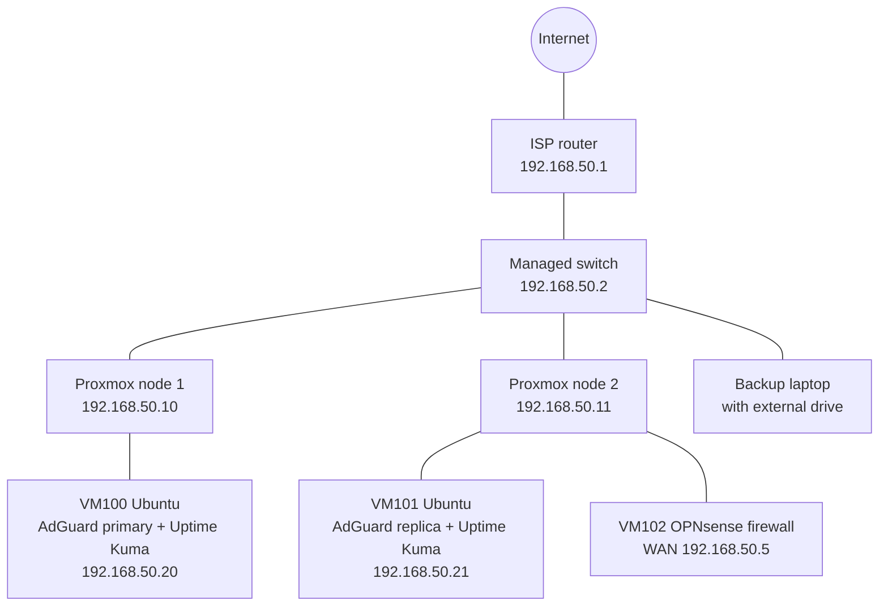
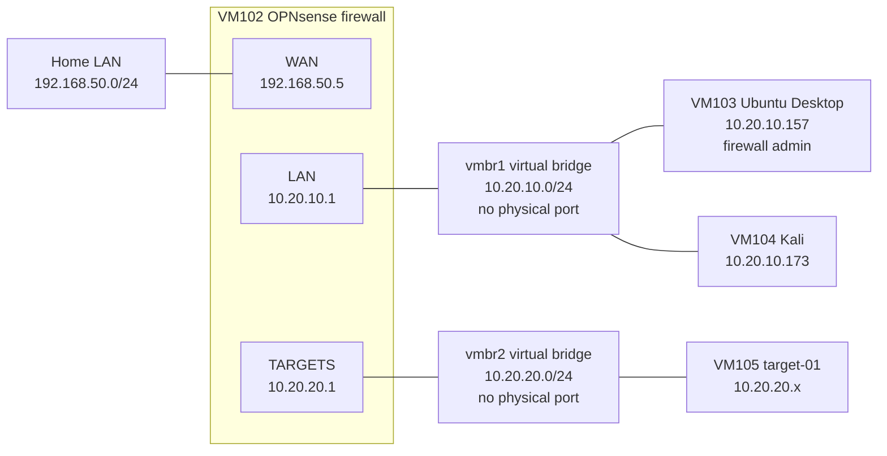
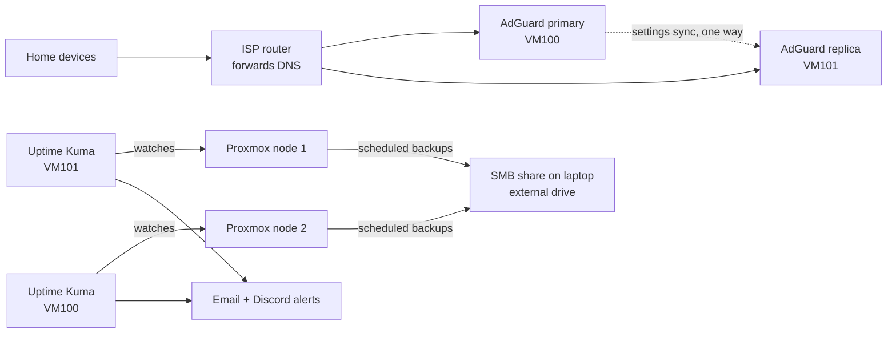

# Network diagram

Overview of the two-node Proxmox home lab. IP addresses are examples. Diagrams are written in Mermaid, which GitHub renders automatically.

## 1. Home network and where each VM runs

Node 1 runs production services. Node 2 runs the second DNS server and monitor plus the isolated security lab behind OPNsense (shown in diagram 2). The nodes are standalone (no cluster).

## 2. Isolated lab behind OPNsense

Both lab bridges have no physical port and no host IP, so the only way between the lab and anything else is through OPNsense.

## 3. What can talk to what

| From | To | Result |
|---|---|---|
| Kali (`10.20.10.x`) | Target network (`10.20.20.0/24`) | Allowed, through OPNsense and logged |
| Kali, VM103 | Internet | Allowed, through OPNsense (NAT) |
| Kali, VM103 | Home LAN, Proxmox nodes, DNS servers | Blocked |
| Kali | OPNsense web interface | Blocked (only VM103 is allowed) |
| VM103 | OPNsense web interface (HTTPS) | Allowed |
| Targets (`10.20.20.x`) | Anything | Blocked, except DHCP, DNS and ping to the firewall itself |
| Home LAN | Lab networks | No route |
| Uptime Kuma hosts | OPNsense WAN address | Ping only |
| Kali and VM103 | Each other | Not filtered (same segment) |

## 4. Supporting flows

- **DNS:** devices use the router, which forwards to both AdGuard servers. If one is down, the other answers.
- **Monitoring:** each Kuma instance watches the node the other one runs on, so a surviving node can raise the alert. Alerts go out by email and Discord.
- **Backups:** each node backs up its own VMs to a shared folder on a laptop-attached external drive. Snapshots are kept on the nodes for quick rollback but are not counted as backups.

## Legend and notes

- Solid lines are network links; dotted lines are logical relationships.
- `vmbr0` is the bridge attached to the home network, `vmbr1` and `vmbr2` are virtual-only bridges on node 2.
- SSH password login is disabled on the Ubuntu VMs (VM100, VM101, VM103); only key-based login works. Proxmox web logins use named accounts with two-factor authentication.
